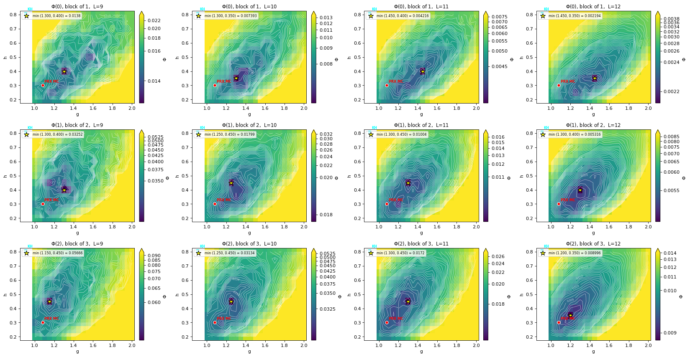
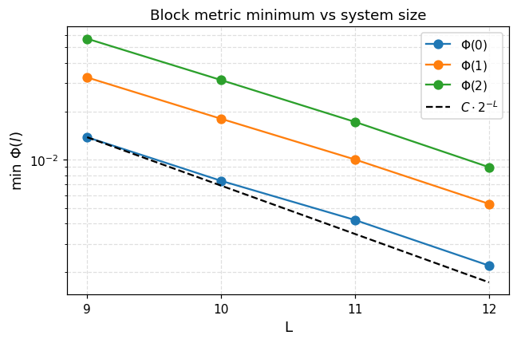
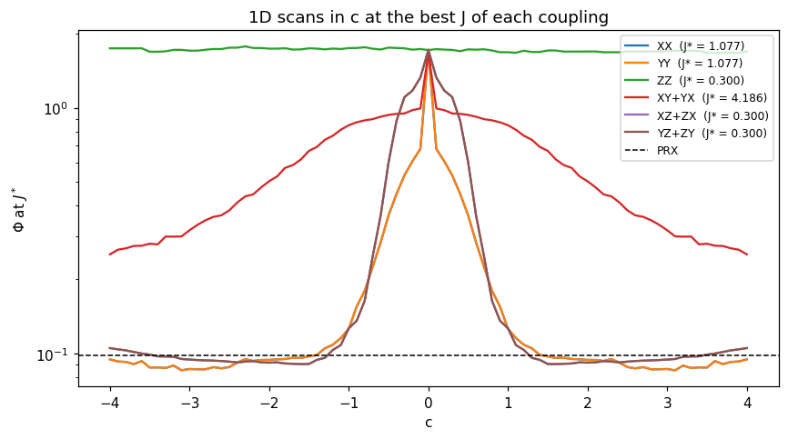
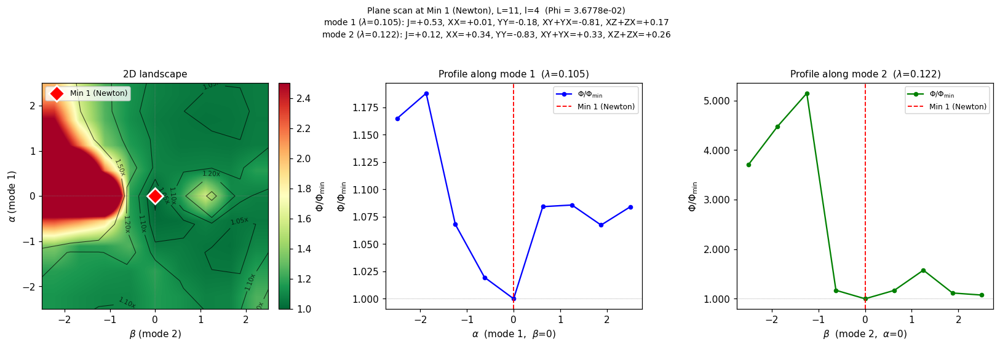
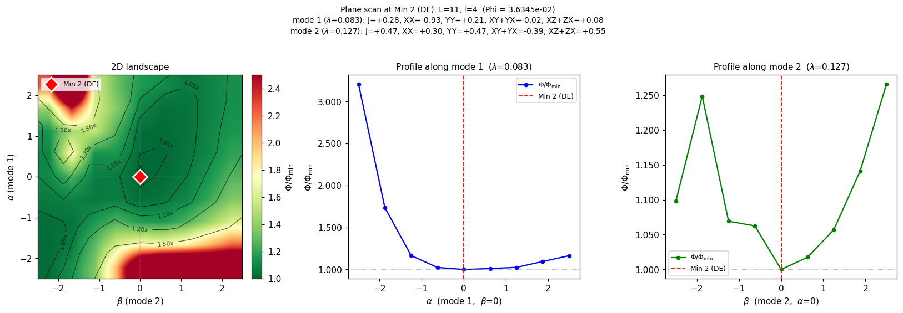

# Adjacent-spin thermalization

How thermal are the eigenstates of a chaotic spin chain, and can extra two-spin couplings make them more thermal? This repository measures eigenstate thermalization in the mixed-field Ising chain with a block ETH metric $\Phi(l)$. It then searches the space of nearest-neighbour two-spin couplings for Hamiltonians whose eigenstates are locally closer to one another than at the standard tilted-field point.

## The model and the metric

The baseline is the mixed-field Ising model (MFIM) on an open chain of $L$ spins,

$$H(g, h) = \sum_i Z_iZ_{i+1} + g\sum_i X_i + h\sum_i Z_i + 0.25\,Z_0 - 0.25\,Z_{L-1},$$

where the edge fields break reflection symmetry. Let $\rho(j, l; n)$ be the reduced density matrix of the $l+1$ contiguous spins $j, \dots, j+l$ in the $n$-th eigenstate. The metric

$$\Phi(l) = \underset{j,\,n}{\mathrm{mean}}\ \mathrm{Tr}\big[(\rho(j, l; n+1) - \rho(j, l; n))^2\big]$$

averages over all block positions $j$ and all consecutive eigenstate pairs in the middle 50 % of the spectrum. **Lower $\Phi$ means more thermal.** For $l = 0$ it equals half the single-site expectation-value metric of the earlier Huse–Khemani project.

The coupling search uses a *canonical* parametrization that removes the exact invariances of $\Phi$:

$$H(x) = J\sum_i Z_iZ_{i+1} + \sum_i Z_i + \text{edge} + \sum_{c} x_c \sum_i O^{(c)}_{i,i+1}, \qquad c \in \{XX, YY, XY{+}YX, XZ{+}ZX, YZ{+}ZY\}.$$

## Main results

The table compares Φ at the PRX point $(g, h) = (1.08, 0.30)$ with the two optima found by the search. *Min 1* comes from a Newton-type search over all six parameters. *Min 2* comes from differential evolution at fixed $J = J_\mathrm{PRX}$. Parameters are given in the standard frame ($c_{YZ+ZY} = 0$).

| | L = 9, l = 3 | | | L = 11, l = 4 | | |
|---|---|---|---|---|---|---|
| | **PRX** | **Min 1** | **Min 2** | **PRX** | **Min 1** | **Min 2** |
| $\Phi$ | 9.814e-2 | 7.154e-2 | 7.031e-2 | 4.553e-2 | 3.678e-2 | 3.635e-2 |
| improvement over PRX | 1 | 1.372× | 1.396× | 1 | 1.238× | 1.253× |
| $J$ | | +0.0823 | +0.0639 | | +0.0723 | +0.0639 |
| $c_{XX}$ | | +0.5364 | +0.3066 | | +0.5607 | +0.4826 |
| $c_{YY}$ | | +0.7627 | +1.1601 | | +0.7317 | +1.3899 |
| $c_{XY+YX}$ | | −0.4427 | +0.3884 | | −0.4501 | −0.2143 |
| $c_{XZ+ZX}$ | | +0.3585 | +0.7534 | | +0.3628 | +0.8783 |
| level-spacing $\langle r\rangle$ | 0.5434 | 0.5683 | 0.5787 | 0.5570 | 0.5936 | 0.6044 |

* Both optima are local minima: every eigenvalue of the reduced standard-frame Hessian is positive, and plane scans along the softest modes find nothing lower nearby.
* The gain over PRX shrinks with system size, and the minima become much shallower: Hessian eigenvalues drop by about 7–10× from L = 9 to L = 11.
* The optimized Hamiltonians are complex (XY+YX and YZ+ZY are imaginary). Their level statistics move from GOE ($\langle r\rangle = 0.531$) towards GUE (0.600).

### Comparison with random states (notebooks 06 and 07)

* **Haar baseline.** Haar-random (GOE/GUE) eigenbases give $\Phi = 0.0658$ (real) and $0.0623$ (complex) at L = 9, l = 3. The spread of the averaged $\Phi$ is 1.7× larger than an independent-pairs estimate, because neighbouring pairs and overlapping blocks are correlated. PRX sits at 1.49× the real baseline.
* **Energy conservation.** Random states confined to narrow energy windows of $H$ reproduce PRX's $\Phi$ to within 1% at L = 9, 0.4% at L = 11 and four decimal places at L = 13. PRX's excess over Haar is therefore a consequence of energy conservation, not of non-random eigenstates.
* **Time-reversal symmetry costs more once energy is conserved.** For structureless states, real vs complex changes $\Phi$ by only about $1 + 1/(m+1)$: 5.7%, 3.0% and 1.5% at l = 3, 4 and 5. Within narrow energy windows, mixing PRX's eigenstates with complex rather than real coefficients lowers $\Phi$ by up to 28% at L = 9, 19% at L = 11 and 12% at L = 13. That is five to eight times the counting factor: the cost falls with size, but more slowly. Restoring time reversal in the optimized couplings, at fixed coupling strengths, raises $\Phi$ by 5–13% at L = 9 and 11. At L = 13, where the L = 11 parameters are reused because no L = 13 search exists, it raises $\Phi$ by 3–5%.
* Equation numbers in notebooks 06 and 07 refer to the analytical note `phi_analytical_calculation.pdf`, which is not included in this repository.

## Figures

**Φ over the MFIM parameter plane.** Rows are blocks of 1, 2 and 3 spins ($l = 0, 1, 2$); columns are $L = 9$ to $12$. The red dot is PRX, the star the grid minimum, and the cyan "KH" label the Kim–Huse point, just outside the grid. The grid minima lie at $g = 1.15$–$1.45$, $h = 0.35$–$0.45$, a little above and to the right of PRX. *(notebook 02)*



**System-size scaling.** The grid minimum of $\Phi(l)$ roughly halves with each added spin. That is close to the dashed $2^{-L}$ line, the inverse Hilbert-space dimension, which is the scaling ETH predicts for squared differences between neighbouring eigenstates. *(notebook 02)*

<p align="center"></p>

**One coupling at a time ($L = 9$).** $\Phi$ for $J\,ZZ + Z + \text{edge} + c\,O$ as a function of $c$, at the best $J$ for each two-spin term $O$. On their own, XX/YY and XZ+ZX/YZ+ZY get 8–12 % below PRX (dashed). Optimizing all couplings together (Min 1, Min 2) gets 27–28 % below. *(notebook 03)*

<p align="center"></p>

**The optima are local minima ($L = 11$).** $\Phi/\Phi_\mathrm{min}$ in the plane of the two softest Hessian modes, with profiles along each mode. Both optima are the lowest point of their scans. *(notebook 05)*




## Repository layout

```
src/spin_eth/        Python package
  operators.py         Pauli matrices, tensor products, MFIM terms, two-site couplings
  metrics.py           reduced density matrices, Phi(l), level-spacing ratio
  models.py            CanonicalModel, PRX -> canonical map, standard-frame rotation
  scans.py             (g, h) landscape scans, one diagonalization per grid point
  analysis.py          finite-difference Hessians, mode summaries, plane scans
  search.py            L-BFGS-B / differential-evolution drivers and minimum checks
  plotting.py          landscape and plane-scan figures
notebooks/
  01_block_eth_metric.ipynb     Phi(l) built step by step; Phi(0), Phi(1) landscapes (L = 9-11)
  02_phi_landscapes.ipynb       Phi(0..2) and Phi(5) landscapes for L = 9-12; spectral-window check
  03_two_spin_search_L9.ipynb   single-coupling scans; Min 1 (Newton) and Min 2 (DE) at L = 9
  04_verify_minima_L9.ipynb     Hessians in several frames, J-direction check, <r>, H* symmetry
  05_L11.ipynb                  the search repeated at L = 11
  06_random_state_baselines.ipynb   exact random-state statistics of Phi; Haar null for the averaged metric
  07_energy_conservation.ipynb      energy-constrained baselines; time-reversal symmetry under energy conservation
scripts/
  compute_landscapes.py         writes results/landscapes/mfim_L{L}.npz
  run_L11_search.py             writes results/L11_search.json
results/                        cached outputs; minima.json holds the optima used downstream
figures/                        saved figures
tests/                          pytest suite (physics checks + equivalence with the original code)
```

## Installation and reproduction

```bash
git clone https://github.com/hotsoup1415/Optimizing-thermalization.git
cd Optimizing-thermalization
pip install -e ".[notebooks,dev]"
pytest                                                    # about 2 s
python scripts/compute_landscapes.py --workers 5          # L = 9-12, about 1-2 h; ~1.5 GB per worker
python scripts/run_L11_search.py                          # about 1.5-3 h
jupyter lab notebooks/
```

Notebooks 01, 02 and 05 only read the cached files in `results/`, so they run in seconds to minutes. Notebook 03 runs the L = 9 searches (about 30–60 min) and notebook 04 the L = 9 checks (about 10 min). Notebooks 06 and 07 are self-contained. Notebook 06 takes about 4 min. Notebook 07 takes about 33 min with its L = 13 option (`INCLUDE_L13`, on by default; it needs a few GB of free memory) and about 8 min without it. Each has a `QUICK` switch for a pass of under a minute. Tested with Python 3.13, NumPy 2.3, SciPy 1.16 and Matplotlib 3.10 on an Apple M4.

**BLAS threads.** OpenBLAS starts one thread per core by default. Several such processes running at once compete for the cores and can run 100× slower, so either run the heavy jobs one at a time or cap each with e.g. `OPENBLAS_NUM_THREADS=2`. Capping changes floating-point rounding in the last bit. The L-BFGS-B searches can then stop at a slightly different point along the exact Z-rotation symmetry: the same $\Phi$ and (checked at L = 9) the same standard-frame parameters to within 1e-6, but raw canonical couplings that differ around the fourth decimal, and different evaluation counts. The outputs in this repository were produced one job at a time with the default thread count.

## Conventions and glossary

| Term | Meaning |
|---|---|
| **PRX** | The tilted-field reference point $(g, h) = (1.08, 0.30)$ of the MFIM, labelled "PRX MC" in the landscape plots. <!-- TODO: cite the paper this point comes from --> |
| **KH** | $(g, h) = (0.9045, 0.8090)$ from H. Kim and D. A. Huse, *Phys. Rev. Lett.* **111**, 127205 (2013). |
| $l$ | Block extension: $\Phi(l)$ uses blocks of $l + 1$ adjacent spins. |
| spectral window | Eigenstates with indices in $[\lfloor 0.25D\rfloor, \lfloor 0.75D\rfloor)$ for Hilbert-space dimension $D = 2^L$. |
| **canonical frame** | Gauge with no X field ($g = 0$, after a uniform Y rotation) and unit Z field ($h = 1$, using scale invariance). Parameters $x = [J, c_{XX}, c_{YY}, c_{XY+YX}, c_{XZ+ZX}, c_{YZ+ZY}]$. The PRX point maps to $J_\mathrm{PRX} = \cos^2\theta / h' \approx 0.0639$ with $\theta = \arctan(g/h)$ and $h' = \sqrt{g^2 + h^2}$. |
| **standard frame** | The canonical frame with the residual uniform Z rotation fixed by $c_{YZ+ZY} = 0$, $c_{XZ+ZX} > 0$. It leaves $\Phi$ unchanged. |
| **Min 1 / Min 2** | The optima from the Newton (L-BFGS-B + Hessian) search and the differential-evolution search. |
| site order | Site 0 is the leftmost tensor factor, i.e. the most significant bit of a basis index. |

Hessians are central finite differences with step 0.05 (5×5) or 0.06 (6×6). The L = 9 optima in `results/minima.json` are stored at the precision the downstream analyses used. Notebook 03 regenerates them and reports the difference.

## License

MIT. See [LICENSE](LICENSE).
